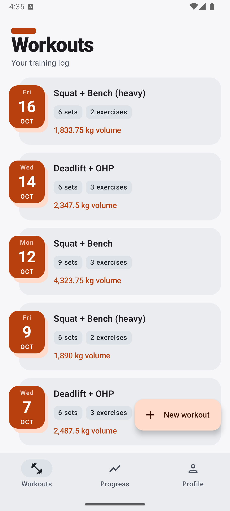
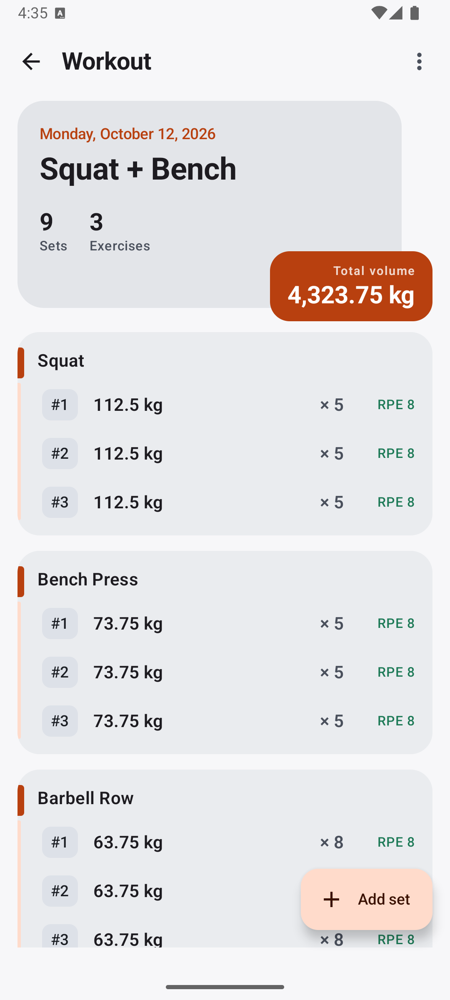
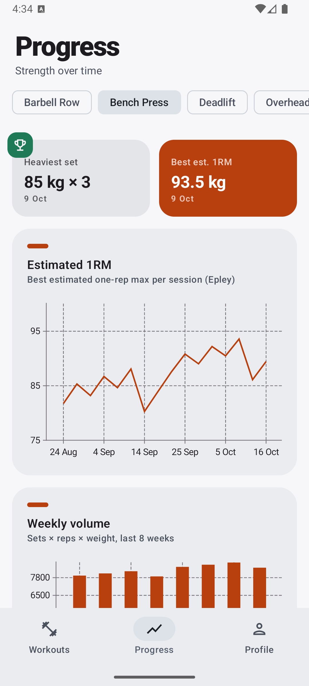
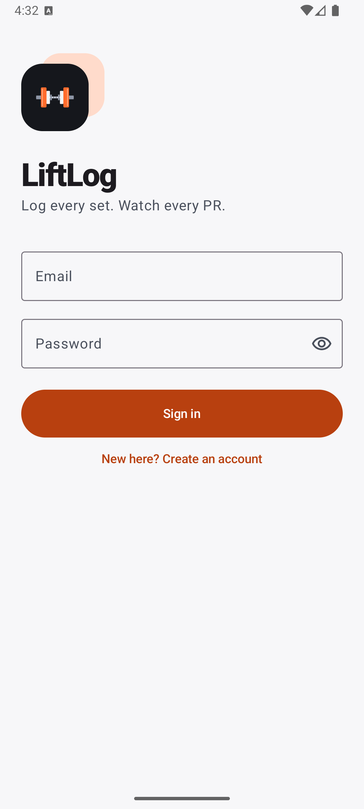
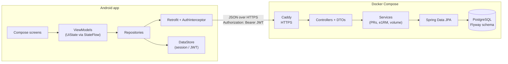

# LiftLog

[](https://github.com/KedyliCali/liftlog/actions/workflows/ci.yml)

**Try it:** <https://liftlog-web.onrender.com> (on iPhone: Share → Add to Home Screen) ·
API docs: <https://liftlog-api-evn4.onrender.com/swagger-ui.html>. Free hosting: the first request
after a quiet period wakes the API and takes about 50 seconds.

A workout tracker with two clients: a native Android app (Kotlin, Jetpack Compose) and a web
app you can install on an iPhone home screen (React, PWA). Log workouts, exercises and sets,
then follow your personal records and estimated one-rep max over time. Both clients talk to
the same JWT-secured Spring Boot REST API backed by PostgreSQL, packaged with Docker.

<p>
  
  
  
  
</p>

## Features

- **Workouts and sets:** create, edit and delete workouts. Add sets with reps, weight and optional RPE. The next set is pre-filled from the previous one.
- **Exercises:** 16 built-in lifts and 16 calisthenics moves (pull-up, dip, muscle-up, pistol squat… and weighted versions), plus your own. The picker is grouped by muscle group with a bodyweight filter.
- **Calisthenics:** bodyweight sets log only the extra load ("BW + 10 kg"); volume, PRs and e1RM add your profile body weight, so a weighted pull-up and a plain one compare fairly.
- **No sign-up form:** each installation silently creates its own account (random credentials kept on the device) and authenticates with JWT. Every account sees only its own data.
- **Recovery code:** the web app's hidden account can be carried to a new phone or back after Safari data is cleared: Profile shows, copies and shares a code, a new device restores with it, and "New code" signs every other device out.
- **Profile:** name, height, body weight, BMI and a profile photo (resized to 256 px on the device before upload).
- **In the gym:** rest timer after each set (vibration, plus a tone on iPhone), swipe a set or workout away with undo, start a new workout from a past one with its weights, confetti on a new PR.
- **Nutrition:** search a built-in list of 315 Turkish dishes, breakfast foods, street food and basic ingredients (per-100 g values plus a typical serving; pick servings in halves or grams) or enter foods by hand. Tracks calories, protein, carbs and fat, shows where the day's calories came from, daily goals shown as two overlapping rings (with a protein suggestion of 1.8 g per kg body weight), one-tap "eat again" for your most frequent foods, swipe to delete with undo, and a day switcher.
- **League of Legends tracker:** follow yourself and friends by Riot ID; a leaderboard by rank and LP, and per-player win rate, KDA, CS per minute, last ten results, top champions and recent matches. Riot data is cached on the server and refreshed lazily within a personal key's rate limits ([setup](docs/RIOT.md)).
- **Progress:** heaviest set and best estimated 1RM per exercise, an e1RM trend chart and weekly training volume.
- **PR alerts:** the app celebrates when a new set beats your previous best.
- **English and Turkish UI**, light and dark theme following the system.
- **Look:** a flat "training equipment" style: near-black panels with hairline borders, one lime signal color (olive in light mode), Barlow Condensed for titles and numbers, one drawn SVG icon set instead of emoji. Fonts are self-hosted so the installed app works offline.
- **Motion:** View Transitions (the tapped workout card morphs into the detail page), a spring-animated nav pill, skeleton loaders shaped like the real cards, count-up totals and a glowing PR tag.

## Tech stack

| Layer | Technology |
| --- | --- |
| Web (iPhone) | React 19, TypeScript, Vite, TanStack Query, React Router, Recharts, PWA (vite-plugin-pwa) |
| Android | Kotlin, Jetpack Compose (Material 3), MVVM + `StateFlow`, Hilt, Retrofit + kotlinx.serialization, Navigation Compose, DataStore, Vico charts |
| Backend | Java 21, Spring Boot 4, Spring Web MVC, Spring Data JPA (Hibernate 7), Spring Security (OAuth2 resource server, HS256 JWT), Bean Validation, springdoc-openapi |
| Database | PostgreSQL 17, schema versioned with Flyway |
| Testing | JUnit 5, Mockito, AssertJ, Testcontainers, MockMvc; JUnit 4, MockK, Turbine and coroutines-test on Android |
| Infrastructure | Docker (multi-stage), Docker Compose, Caddy (automatic HTTPS), GitHub Actions |

## Architecture



Each Android screen follows the same layers. The **Screen** only renders state and forwards
user actions. The **ViewModel** owns the `UiState` (loading / data / error). The
**Repository** decides where data comes from. **Retrofit** does the HTTP call. The backend
mirrors this: Controller → Service → Repository, with DTOs at the edge, so JPA entities are
never serialized directly.

## Project structure

```
liftlog/
├── backend/                 Spring Boot API (controller, service, repository, entity, dto, security, exception)
│   └── src/main/resources/db/migration/   Flyway migrations (V1__init.sql, ...)
├── android/                 Compose app (data/remote, data/local, data/repository, domain/model, ui/*, di)
├── deploy/                  Production compose file + Caddyfile
├── scripts/                 Demo data seeding
├── docs/                    Plan, walkthrough, screenshots
└── docker-compose.yml       Local PostgreSQL (+ API container)
```

## Running locally

**Requirements:** Docker, JDK 21, and Android Studio (or the Android SDK) for the app.

```bash
cp .env.example .env              # then set DB_PASSWORD and a 32+ character JWT_SECRET
docker compose up -d --build      # PostgreSQL on :5433 and the API on :8080
```

Or run only the database in Docker and the API from your IDE:

```bash
docker compose up -d db
cd backend && ./mvnw spring-boot:run
```

- Health check: <http://localhost:8080/api/v1/health>
- Swagger UI: <http://localhost:8080/swagger-ui.html>

**Web:** `cd web && npm install && npm run dev`, then open <http://localhost:5173>. It calls
`http://localhost:8080` unless `VITE_API_URL` says otherwise. The dev server is also reachable
from a phone on the same Wi-Fi.

**Android:** open `android/` in Android Studio and run on an emulator. Debug builds call
`http://10.0.2.2:8080/`, which is the host machine as seen from the emulator.

**Demo data:** creates a local demo account with eight weeks of training, so the Progress
tab has something to show:

```bash
python scripts/seed_demo_data.py
```

## API

All endpoints are under `/api/v1`. Everything except `auth/register`, `auth/login` and
`health` needs `Authorization: Bearer <token>`.

| Method | Path | Description |
| --- | --- | --- |
| POST | `/auth/register` | Create an account, returns a JWT |
| POST | `/auth/login` | Sign in, returns a JWT |
| GET | `/auth/me` | Current user |
| GET / POST | `/exercises` | Built-in + own exercises / create a custom one |
| GET | `/workouts?page=0&size=20` | Paged workout summaries, newest first |
| GET / PUT / DELETE | `/workouts/{id}` | Workout with its sets / update / delete |
| POST | `/workouts` | Create a workout |
| POST | `/workouts/{id}/sets` | Add a set (response flags a new personal record) |
| PUT / DELETE | `/sets/{id}` | Update / delete a set |
| GET | `/stats/prs` | Heaviest set and best estimated 1RM per exercise |
| GET | `/stats/progress?exerciseId=1` | Per-session top weight, e1RM and volume |
| GET | `/stats/volume?weeks=8` | Weekly volume, gaps filled with zero |
| GET | `/nutrition/days/{date}` | A day's food entries, totals and goals |
| POST / DELETE | `/nutrition/entries`, `/nutrition/entries/{id}` | Log / remove a food |
| GET | `/nutrition/frequent` | Most eaten foods of the last 60 days, for quick add |
| PUT | `/nutrition/goals` | Daily calorie and protein goals (null clears) |
| GET / POST | `/lol/players` | Followed League players with rank / follow a Riot ID |
| GET / DELETE | `/lol/players/{puuid}` | Stats and recent matches / unfollow |
| POST | `/lol/players/{puuid}/refresh` | Fetch fresh data from Riot (at most once a minute) |
| PUT | `/profile/password` | Change the password (the web app's "New code"); every older token stops working |
| GET | `/foods` | Built-in food catalog (Turkish and English names, per 100 g and per serving) |

Errors always use the same shape:

```json
{ "timestamp": "...", "status": 400, "error": "Bad Request", "message": "Validation failed",
  "path": "/api/v1/workouts/1/sets", "fieldErrors": { "reps": "must be greater than or equal to 1" } }
```

## Testing

```bash
cd backend && ./mvnw verify                  # unit tests + Testcontainers integration tests (needs Docker)
cd android && ./gradlew testDebugUnitTest    # ViewModel tests with fake repositories
cd web && npm test                           # Vitest: validation, session handling, page logic
```

- **Backend:** service unit tests (Mockito), MVC slice tests for validation and the error format, and integration tests that run the real security chain, Flyway schema and PostgreSQL in a container. These cover 401s, registration rules, per-user isolation, PR detection and the SQL weekly-volume query.
- **Android:** ViewModel tests for loading and error states, paging, refresh on resume, set validation, automatic sign-in and progress selection.
- **Web:** unit tests for form validation, the device-account sign-in (first visit, return visit, server reset, 401 handling) and page logic such as templates and chart ranges.
- **CI:** GitHub Actions runs both suites, Android lint and a Docker image build on every push and pull request.

## Design decisions

- **`NUMERIC(6,2)` for weights, not `FLOAT`:** 2.5 kg plates must add up exactly, and binary floating point cannot represent many decimal values.
- **PRs are computed, not stored:** records are derived from sets on each request, so editing or deleting a set can never leave a stale PR behind.
- **Entity and DTO are separate:** the API contract stays stable when the database changes, and lazy JPA relations are never serialized by accident.
- **404 for other users' data:** a foreign workout looks exactly like a missing one, so IDs reveal nothing.
- **`CurrentUserProvider` interface:** the MVP used a demo user, and adding JWT meant swapping a single implementation. Services did not change.
- **JWT with Spring's resource server:** tokens are issued with Nimbus and validated by Spring Security's own filter, so no hand-written filter or extra JWT library is needed.
- **Login gives no hints:** login returns the same error for an unknown email and a wrong password, and runs a dummy BCrypt check so response timing does not reveal registered emails.
- **Device accounts instead of a login form:** for a personal tracker a sign-up form is friction. Each client generates a random email and a 256-bit password once, stores them locally and signs in silently. A 401 drops the token and the same credentials sign in again; if the server lost the account, it is recreated.
- **Photos live in PostgreSQL:** Render's free disk is wiped on every restart, so avatars are stored as `BYTEA` in their own table (never loaded with the user), capped at 512 KB, and their type is detected from the file's magic bytes rather than trusted from the request.
- **Bodyweight load = body weight + added weight, computed in SQL:** sets store only the added load, and queries add `users.body_weight_kg` for exercises flagged `bodyweight`. Changing body weight later re-scores old sets with the new value; that is a deliberate simplification instead of versioning weight history.
- **Food catalog searched on the phone:** the ~100-row list is sent once and cached for a day; searching locally gives instant results and folds Turkish letters ("corba" finds "çorba"). Entries copy the calculated kcal and protein, so correcting the catalog never rewrites past days.
- **Frequent foods are computed, not stored:** like PRs, the quick-add list is a `GROUP BY` over the last 60 days of entries, so there is no favorites table to keep in sync. The client sends its own calendar date, so "today" follows the phone's time zone.
- **Riot behind an interface, with a rate limiter:** the service only knows `RiotClient`; the HTTP version adds the key header server-side and takes a slot from a limiter set below the personal key's limits, a fake version generates data for local work, and a third reports "not configured" so the app runs without a key. Refreshes are lazy (stale after ten minutes) and fall back to cached data when Riot is unavailable.
- **Recovery code = the device's own credentials:** the code is `uuid.password` from the device account, so restoring is an ordinary login and the server stores no second secret. "New code" is a password change that raises `users.token_version`; every JWT carries the version as `ver`, and a validator rejects older ones on the next request (tokens without the claim count as 0, so the release signed nobody out).
- **Undo instead of "Are you sure?":** a swiped-away set is hidden at once and only deleted on the server when the 5-second undo window closes.

## Deployment

**Hosted (free):** the API and the web app run on [Render](https://render.com) from `render.yaml`
(a Docker web service built from `backend/Dockerfile`, and a static site built from `web/`). PostgreSQL runs on [Neon](https://neon.tech). Every backend change merged
to `main` redeploys automatically. On the free plan the API sleeps after 15 idle minutes, and the
next request waits for a cold start: about 50 seconds at 0.1 CPU, down from 3 minutes thanks to a
class data sharing archive built into the image and C1-only JIT (measurements in docs/DEPLOY.md). The app shows a
"waking up" hint and its timeouts cover the wait. Step-by-step setup (Turkish):
[docs/DEPLOY.md](docs/DEPLOY.md).

**Self-hosted:** `deploy/docker-compose.prod.yml` runs PostgreSQL, the API and Caddy on one Linux server.
Caddy gets an HTTPS certificate for `DOMAIN` automatically. Only ports 80 and 443 are public;
the database has no published port.

```bash
docker compose -f deploy/docker-compose.prod.yml --env-file .env up -d --build
```

Release APKs point at the deployed API:

```bash
cd android && ./gradlew assembleRelease -PliftlogApiUrl=https://your-domain/
```

Signing reads `android/keystore.properties` (git-ignored). Without it the release build is unsigned.

## Status

The MVP, accounts and progress features are done. Next: a public deployment and an APK on
GitHub Releases, a rest timer and workout templates (v1.3), and offline support with Room (v2.0).
See [docs/PLAN.md](docs/PLAN.md) for the full roadmap and [PROGRESS.md](PROGRESS.md) for the log.
